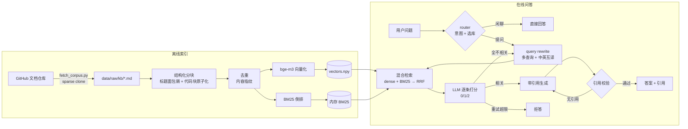

# 架构设计说明

## 1. 整体链路



## 2. 为什么这么设计（每条都能在面试里展开讲）

### 2.1 分块：结构优先，字符数兜底
固定窗口切分会把「标题 + 正文 + 代码」切散。本项目先用 Markdown 标题切段，再段内装箱：

- **标题面包屑**（`Tutorial > Query Parameters`）会拼进 `embed_text`，向量和 BM25 都能用上「位置信息」；
- **代码块是原子**，绝不跨块切断，否则模型看到的是半个示例，一定照着编；
- **段内贪心装箱 + 尾块重叠**，控制 token 预算；超长代码用行级硬切兜底。

代价：块长不齐（120~600 token），但检索质量明显高于等长切分。想量化就走 `scripts` 里的检索评测。

### 2.2 检索：混合 + RRF，而不是单一向量
| 场景 | 向量检索 | BM25 |
|---|---|---|
| 「依赖注入怎么写」 | ✅ 语义对得上 | ❌ 词不匹配 |
| 「HTTPBearer 报 403」 | ❌ 专有名词方向不稳 | ✅ 精确命中 |
| 中文问英文文档 | ✅（bge-m3 跨语言） | ❌ |

两路分数尺度不可比，用 **RRF（Reciprocal Rank Fusion）** 只看排名融合，几乎不用调参：

```python
score(doc) = Σ  w_i / (k + rank_i(doc))     # k=60, w_dense=0.5, w_bm25=0.5
```

跨知识库检索时再做一层 RRF —— 不同库的相似度分布差异更大，直接比大小会「一个库通吃」。

### 2.3 生成前后各加一道闸
- **生成前**：LLM 逐条给候选打分（0 不相关 / 1 部分相关 / 2 直接相关），只保留 ≥1 的片段。相当于 CRAG 的 retrieval evaluator。
- **生成后**：正则抽出 `[n]` 引用编号，校验编号是否落在上下文范围内。一个有效引用都没有 → 判定 ungrounded，**带着「必须引用」的强指令重生成一次**。
- 检索全空且重试超限 → 明确拒答，而不是让模型自由发挥。

这套「检索评估 + 引用校验」是压幻觉最划算的两个改动，成本只有 1~2 次额外 LLM 调用。

### 2.4 状态与记忆
- `RAGState` 是 `TypedDict`，字段全部可 JSON 序列化，可存 SQLite/Postgres 检查点；
- `steps` 用 `Annotated[..., operator.add]` 做累加，前端能拿到完整执行轨迹；
- 每轮 `router` 节点会重置 `attempts / candidates / relevant / answer`，避免检查点里的历史状态污染新一轮；
- `messages` 用 LangGraph 的 `add_messages` reducer，多轮记忆天然带上。

### 2.5 两种 Agent 形态
| | 固定编排（CRAG 图） | 自主 ReAct |
|---|---|---|
| 控制流 | 代码写死，条件边决定 | 模型决定调哪个工具、调几次 |
| 成本 | 可预测（3~5 次 LLM） | 不可预测（可能 10+ 次） |
| 可测试性 | 每个节点独立可测 | 只能端到端测 |
| 适合 | 线上问答、SLA 敏感 | 探索型问题、工具多而杂 |

面试里被问「你怎么选」，能说出这张表就够了。

## 3. 关键数据流

**索引产物**（`data/index/<kb>/`）：

```
meta.json      # 文档数、片段数、embedding 模型、git sha、构建时间
chunks.jsonl   # 一行一个片段，可直接 grep / 人工 review
vectors.npy    # (n, 1024) float32，已 L2 归一化
ids.json       # 行号 -> chunk_id
```

设计取舍：
- **不落 BM25 索引**：启动时用 chunks 重建（10k 片段约 1s），换取「索引永远和正文一致」，避免序列化版本漂移；
- **向量归一化后存**：余弦相似度退化为点积，检索是一次 `matmul`，10 万片段毫秒级；
- **chunks.jsonl 而不是 pickle**：可 diff、可 grep、可增量，方便调试。

## 4. 并发与性能

| 环节 | 做法 |
|---|---|
| 向量化 | 批量 32 条 + 4 并发 + 3 次指数退避重试，按内容哈希缓存 |
| 检索 | 纯 NumPy 矩阵运算，`asyncio.to_thread` 避免阻塞事件循环 |
| 建库 | 后台 `asyncio.Task` + 进度状态机，API 只返回 202，前端轮询 |
| 流式 | SSE，事件区分 `step / token / final`，网关加 `X-Accel-Buffering: no` |

## 5. 已知取舍 / 下一步

- 检查点是内存版 `MemorySaver`，进程重启即失忆 → 换 `SqliteSaver` / `PostgresSaver`；
- 无鉴权、无租户隔离 → 生产要加 API Key + KB 级 ACL；
- rerank 是规则版，效果上限低于 cross-encoder → 换 `bge-reranker-v2-m3`；
- 没有增量索引（改一篇文档全量重建）→ 用内容指纹做 diff；
- 没有 tracing → 接 LangSmith / OpenTelemetry。
